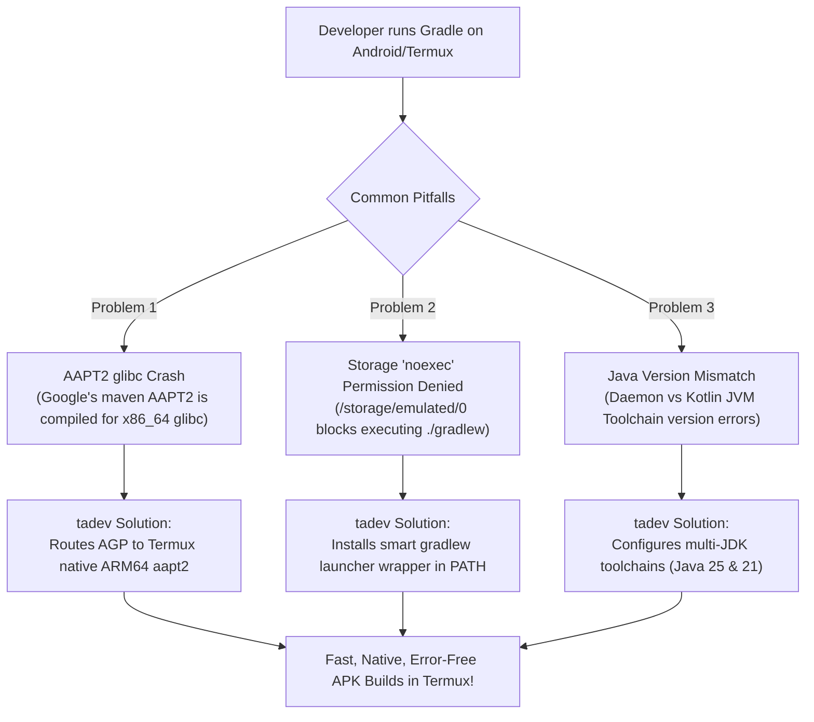

# termux-android-dev (tadev)

[](https://github.com/rugved-danej/termux-android-development/releases)
[](https://github.com/rugved-danej/termux-android-development/actions)
[](https://tadev.vercel.app)
[](LICENSE)
[](https://termux.dev)
[](https://github.com/rugved-danej)

> **The modern, interactive Android APK development and build engine engineered exclusively for Termux on Android.**
> Authored and maintained by **Rugved Danej** ([@rugved-danej](https://github.com/rugved-danej)).
> Features an advanced interactive TUI dashboard, granular uninstaller with self-removal, official OpenJDK 21 LTS (recommended) & 25/17 multi-profile management, native ARM64 AAPT2 overrides, dynamic RAM auto-tuning, and cross-platform architecture support across **Termux on Android** (`arm64`, `arm`, `x86_64`, `386`) — distributed as a **zero-dependency standalone native binary**.

---

## Documentation Website

Full documentation, architecture internals, and guides are available on the official documentation site:
**[https://tadev.vercel.app](https://tadev.vercel.app)** (Powered by [Fumadocs](https://fumadocs.dev))

---

## 1-Line Quick Install

Install globally inside Termux with a single copy-paste command (no Go installation required):

```bash
bash <(curl -sL https://raw.githubusercontent.com/rugved-danej/termux-android-development/main/install.sh)
```

The installer detects your device's architecture (`arm64`, `arm`, `amd64`, `386`), downloads the optimized native binary to `$PREFIX/bin/tadev`, and creates the canonical symlink `$PREFIX/bin/termux-android-dev`.

---

## Universal Device Support

`tadev` automatically adapts its paths, JVM toolchains, and package managers across every device ecosystem:

| Device Category | Supported Environments | Architectures |
| :--- | :--- | :--- |
| **Android Phones & Tablets** | Termux on physical Android devices | `arm64` (aarch64), `arm` (32-bit) |
| **Foldables & Large Screens** | Samsung DeX, Motorola Ready For, Pixel Fold | `arm64`, `x86_64` |
| **Chromebooks (ChromeOS)** | Termux on ChromeOS ARCVM / Crostini Linux container | `x86_64`, `arm64` |
| **PCs & Laptops** | Waydroid, Android-x86, BlissOS, WSA on Windows 11 | `x86_64`, `arm64` |
| **Native Linux / Docker** | Debian, Ubuntu, Arch, Fedora, Alpine containers | `amd64`, `arm64`, `arm`, `386` |

---

## Why termux-android-dev?

Building native Android APKs on an Android device using Termux has historically run into three major bottlenecks:



---

## Features

| Feature | Description |
| :--- | :--- |
| **Zero Go Dependencies** | End users do **not** need Golang installed. Shipped as a standalone native ELF binary. |
| **Interactive TUI Dashboard** | Simply type `tadev` to launch an interactive menu with keyboard navigation, hotkeys, and border styling. |
| **Granular Uninstaller** | Interactive multi-select checkbox TUI lets you choose exactly which components to uninstall (or keep). |
| **Complete Self-Removal** | Option to completely remove the `tadev` CLI tool itself and its configuration from your device. |
| **Fluid Braille Animations** | High-framerate UTF-8 braille spinners (`⠋ ⠙ ⠹...`), gradient color cycling, live elapsed timers, and zero emojis. |
| **Multi-JDK Toolchains** | Configures active **OpenJDK 25 LTS** along with **OpenJDK 21** for Gradle toolchain discovery. |
| **Native ARM64 AAPT2 Override** | Bypasses incompatible desktop binaries by injecting `android.aapt2FromMavenOverride`. |
| **Clean & Hidden SDK** | Keeps `$HOME` tidy by placing the SDK inside the standard hidden path: `~/.android/sdk`. |
| **Advanced YAML Configuration** | Full configuration engine powered by `config.yml` and `tadev config` for granular customization. |
| **Diagnostic Doctor** | Runs comprehensive health checks on all Java, SDK, and build components. |

---

## Interactive TUI Dashboard

Running `tadev` without arguments in an interactive terminal opens the interactive TUI:

```text
Termux Android Development
  [*] Device: Android Phone / Tablet (ARM64 Termux)

  > Install / Setup Environment    - Configure OpenJDK, Android SDK, AAPT2, and shell paths
    Java Profile Manager           - Switch or test active OpenJDK profiles (21, 25+21, 25+17, 21+17, 25, 17)
    Apply All Available Updates    - Download and apply all upgrades for SDK, tools, and packages
    Check for Updates              - Check Google repositories, package repos, and GitHub releases
    SDK Package Manager            - List installed platforms or install extra SDK packages
    Diagnostic Doctor              - Comprehensive health & device environment diagnostics
    Configuration Settings         - Inspect or customize ~/.config/tadev/config.yml
    Upgrade tadev CLI Binary       - In-place self-updater from latest GitHub release
    Uninstall Environment / Tool   - Granular uninstallation chooser or complete removal
    Exit Dashboard                 - Close and return to shell

  [Up/Down] Navigate  [Enter] Select  [Ctrl+D] Detailed Info  [Esc] Exit
```

---

## Command Reference

```text
tadev <command> [options]
# or:
termux-android-dev <command> [options]
```

### Commands

| Command | Alias | Description |
| :--- | :--- | :--- |
| `install` | `setup` | Automatically sets up and configures the complete Android environment |
| `java [switch\|list\|test]` | `jdk` | Manages OpenJDK profiles (21, 25+21, 25+17, 21+17, 25, 17) and tests runtime compatibility |
| `uninstall` | `remove`, `desetup` | Granular uninstallation (interactive chooser or flags) |
| `update` | `upgrade` | Applies all available SDK, tool, and package updates |
| `check` | `check-updates` | Checks for updates across Google repos, package repos, and tadev releases |
| `sdk [list\|install <pkg>]`| `sdkmanager` | Inspects installed platforms or installs extra SDK packages |
| `ndk [status\|install\|list]`| `ndk-manager` | Installs and configures Android NDK with Termux shebang fixes |
| `clean [all\|gradle\|sdk]` | `clear` | Purges temporary build caches and daemons to reclaim storage |
| `completion [shell]` | `autocomplete` | Generates or installs native shell tab-completion (bash, zsh, fish) |
| `doctor` | `status` | Runs diagnostic health checks on all components |
| `self-update` | `self-upgrade` | In-place upgrade of the `tadev` CLI executable from GitHub Releases |
| `config [action]` | `cfg` | Inspects or initializes configuration (`show`, `init`, `reset`, `path`) |
| `menu` | `tui`, `dashboard` | Launches the interactive terminal UI dashboard |
| `version` | `-v`, `--version` | Displays version and developer attribution |
| `help` | `-h`, `--help` | Displays the help manual |

---

## Java Profile System

`tadev` gives you complete freedom over your Java configuration with hot-switchable profiles. For an in-depth architectural breakdown and complete differences between dual-JDK combinations and single-JDK solos, see [docs/JAVA_PROFILES.md](docs/JAVA_PROFILES.md).

| Profile | Architecture | Host OpenJDK | Gradle Toolchain | Disk Usage | Best For |
| :--- | :--- | :--- | :--- | :--- | :--- |
| `21` | Single-JDK Solo | **OpenJDK 21 LTS** | OpenJDK 21 LTS | ~270 MB | **Recommended Default**: Saves ~300MB, lowest RAM overhead, 100% native AGP compatibility |
| `25+21` | Dual-JDK Combination | **OpenJDK 25** | OpenJDK 21 LTS | ~550 MB | **Dual-JDK Performance**: Fast Termux host + rock-solid Android builds |
| `25+17` | Dual-JDK Combination | **OpenJDK 25** | OpenJDK 17 LTS | ~500 MB | Modern host paired with legacy Java 17 toolchain |
| `21+17` | Dual-JDK Combination | **OpenJDK 21 LTS** | OpenJDK 17 LTS | ~490 MB | LTS host paired with legacy Java 17 toolchain |
| `25` | Single-JDK Solo | **OpenJDK 25 LTS** | OpenJDK 25 LTS | ~280 MB | **Modern Solo**: Single 2025 LTS JDK for Gradle 9+ builds |
| `17` | Single-JDK Solo | **OpenJDK 17 LTS** | OpenJDK 17 LTS | ~220 MB | **Legacy Baseline**: Saves ~330MB, AGP 8.0 baseline |

All profiles use exclusively official Termux stable repository packages (`openjdk-25`, `openjdk-21`, `openjdk-17`). Zero third-party or TUR repositories required.
Zero external dependencies: launches browser via standard Termux tools (`termux-open-url`, `am start --user 0`) without requiring the Termux:API companion app or `termux-api` package.

### Profile Commands

```bash
# Interactive switch menu (press Tab to view differences in browser)
tadev java switch

# Switch directly via CLI argument
tadev java switch 21
tadev java switch 25+17

# Inspect active profile and all installed OpenJDK runtimes
tadev java list

# Run compatibility test across all installed JDKs (javac, gradle, d8, apksigner)
tadev java test
```

---

## Granular Uninstaller & Complete Self-Removal

Running `tadev uninstall` interactively opens the multi-select component chooser:

```text
UNINSTALLATION CHOOSER
  [*] Select components to remove from your system:

  > [x] Android SDK Directory       - ~/.android/sdk (Platforms, build-tools, cmdline-tools)
    [x] Shell Configurations        - Exports & aliases in ~/.bashrc, ~/.zshrc, fish, and profile configs
    [x] Gradle Properties           - AAPT2 override & toolchain paths in ~/.gradle/gradle.properties
    [x] Global 'gradlew' Wrapper    - Smart launcher in $PREFIX/bin/gradlew
    [ ] OpenJDK 25 Runtime          - Package: openjdk-25 (via pkg)
    [ ] OpenJDK 21 Runtime          - Package: openjdk-21 (via pkg)
    [ ] OpenJDK 17 LTS Runtime      - Package: openjdk-17 (via pkg)
    [ ] Gradle Build System         - Package: gradle (via pkg)
    [ ] Android Tools & AAPT2       - Packages: aapt2, apksigner, d8, android-tools
    [x] tadev Configuration & Cache - ~/.config/tadev and update caches
    [ ] Self-Remove tadev CLI Tool  - Delete tadev binary from device

  [Up/Down] Navigate  [Space] Toggle  [a] Toggle All  [Enter] Confirm  [Esc] Cancel
```

### Non-Interactive Uninstall Flags

For scripts, CI, or quick command-line uninstallation:

```bash
# Purge EVERYTHING: SDK, JDKs, Gradle packages, config, AND self-remove tadev
tadev uninstall --all -y

# Self-remove tadev tool and configuration only
tadev uninstall --self -y

# Remove SDK and purge all installed packages (Java 25, 21, Gradle, AAPT2)
tadev uninstall --packages -y

# Remove only the Android SDK directory (~/.android/sdk)
tadev uninstall --sdk-only -y
```

---

## Configuration (`config.yml`)

`tadev` includes an advanced YAML configuration engine. You can inspect, customize, or reset your preferences at any time:

```bash
# View active YAML configuration (with terminal syntax highlights)
tadev config show

# Initialize local config file at ~/.config/tadev/config.yml
tadev config init

# Print absolute path to config file
tadev config path

# Reset config to defaults
tadev config reset
```

Example configuration (`config.yml`):

```yaml
version: "1.0.0"
author: "Rugved Danej"
repository: "https://github.com/rugved-danej/termux-android-development"

android:
  sdk_root: "~/.android/sdk"
  cmdline_tools:
    auto_detect_latest: true
    fallback_build: "15641748"
  platforms:
    - "android-36"
    - "android-35"
  build_tools:
    - "36.0.0"
  aapt2:
    native_override: true
    binary_path: "/data/data/com.termux/files/usr/bin/aapt2"

java:
  profile: "25+21" # Options: "25+21", "21", "26+21", "26", "17", "25+17"
  default_version: "25"
  default_path: "/data/data/com.termux/files/usr/lib/jvm/java-25-openjdk"
  toolchain_paths:
    - "/data/data/com.termux/files/usr/lib/jvm/java-25-openjdk"
    - "/data/data/com.termux/files/usr/lib/jvm/java-21-openjdk"
  jvm_args: "-Xmx2048m -XX:MaxMetaspaceSize=512m -XX:+UseG1GC"

ui:
  animations_enabled: true
  spinner_style: "braille"
  spinner_interval_ms: 75
  show_elapsed_timer: true
  color_theme: "cyberpunk-cyan"
  show_banner: false

updates:
  check_frequency_days: 7
  auto_check_in_shell: true
  quiet_mode: false
```

---

## Building from Source (Developers Only)

```bash
./build.sh
```

---

## Author & Developer

**Rugved Danej**  
- GitHub: [@rugved-danej](https://github.com/rugved-danej)
- Repository: [termux-android-development](https://github.com/rugved-danej/termux-android-development)

---

## License

Distributed under the **MIT License**. See [`LICENSE`](LICENSE) for more details.
